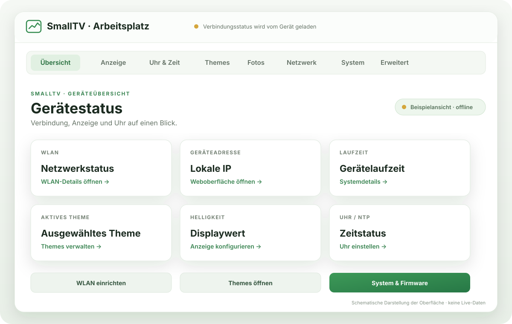

# SmallTV Stable Firmware

Firmwareprojekt für **GeekMagic SmallTV und SmallTV Ultra mit ESP8266**. Die Firmware stellt eine lokale Weboberfläche für Geräteeinstellungen bereit und unterstützt Themes, Playlists, Uhr-Designs und eine lokale Fotobibliothek.

[](https://github.com/jamedegnato-kostal/smalltv-ultra-mod/actions/workflows/build.yml)
[](https://jamedegnato-kostal.github.io/smalltv-ultra-mod/)
[](https://github.com/jamedegnato-kostal/smalltv-ultra-mod/releases)
[](LICENSE)

> **Herkunft:** Dieses Projekt basiert auf dem ursprünglichen [giovi321/smalltv-mod](https://github.com/giovi321/smalltv-mod) von **[@giovi321](https://github.com/giovi321)**. Es ist eine eigenständige, auf SmallTV Ultra / ESP8266 ausgerichtete Stable-Firmware. Die ursprüngliche Lizenz und die Herkunftshinweise bleiben erhalten – siehe [NOTICE.md](NOTICE.md) und [LICENSE](LICENSE).

Dies ist ein **Firmware-Repository**, kein Hardware-Shop und kein offizielles Produkt von GeekMagic. Der Quellcode richtet sich an Entwickler und Besitzer kompatibler Geräte.

---

## Weboberfläche

Die Firmware enthält eine lokal auf dem Gerät gehostete, responsive Weboberfläche. Sie wird im Browser über die IP-Adresse des SmallTV geöffnet. Der [HTML-Quellcode](src/webui_settings.html) ist direkt im Firmware-Repository enthalten. Die folgende Grafik ist eine **schematische Darstellung** der tatsächlichen Navigations- und Statusstruktur; angezeigte Werte sind Platzhalter, keine Live-Gerätedaten.



Die Navigation umfasst Übersicht, Anzeige, Uhr & Zeit, Themes, Fotos, Netzwerk, System und erweiterte Einstellungen. Die Oberfläche unterstützt helle und dunkle Darstellung.

## Funktionsumfang

| Bereich | Funktionen |
| --- | --- |
| **Geräteübersicht** | WLAN-Status, Geräteadresse, Laufzeit, aktives Theme, Helligkeit und NTP-Status |
| **Anzeige** | Helligkeit, Rotation, Backlight-Polarität, RGB/BGR, Invertierung, RGB-Korrektur, Kontrast, Sättigung und Panelrate |
| **Uhr & Zeit** | NTP, Zeitzone, 12-/24-Stunden-Format, Datum, Sekunden und zeitgesteuerter Nachtmodus |
| **Themes** | Installierbare `.stheme`-Pakete, Suche, Filter, Vorschau, Metadaten, Ebenenreihenfolge und Verwaltung |
| **Playlist** | Bis zu 8 Einträge, feste oder zufällige Reihenfolge, Zeitfenster und individuelle Laufzeiten |
| **Fotos** | JPEG-Fotobibliothek, Vorschau, Upload-Fortschritt, Abbruch, Löschen und Shuffle-Wiedergabe |
| **Renderer** | Text, Bilder, Formen, Animationen, transparente Ebenen und optionale PNG-Schriftatlanten |
| **Geräteverwaltung** | WLAN-Einrichtung, mehrere gespeicherte Netzwerke, Konfigurations-Backup, manueller Firmware-Upload und Recovery |

## Unterstützte Hardware

- **Zielplattform:** ESP8266
- **Display:** ST7789, 240 × 240 Pixel
- **WLAN:** 2,4 GHz
- **PlatformIO-Umgebung:** `smalltv_settings`
- **Separates Installationshilfsimage:** `smalltv_loader`

Dieses Stable-Image ist ausschließlich für ESP8266-basierte SmallTV-Geräte ausgelegt. Es enthält den zeitgesteuerten Nachtmodus, aber keine automatische Sprach-/Locale-Zeitplanung, keine physische Tastensteuerung und keinen Web-Login oder Passwortschutz. ESP32-C2-, klassische ESP32- und SmallTV-Pro-Ziele sind nicht Bestandteil dieses Builds. Die erstmalige Installation auf manchen SmallTV-Ultra-Flashlayouts kann einen Loader erfordern; beachte die [Installationshinweise](https://jamedegnato-kostal.github.io/smalltv-ultra-mod/getting-started/flashing/).

### Flashlayout und Migration

Das Firmwareimage ist für einen ESP-12F/ESP-12E mit **4 MB Flash** gebaut. `eagle.flash.4m2m.ld` reserviert 2 MB für LittleFS und lässt einen OTA-fähigen Firmwarebereich von ungefähr 1 MB. Die tatsächlich nutzbare Dateisystemkapazität ist wegen Metadaten etwas kleiner.

Beim Wechsel von der bisherigen `4m1m`-Partitionierung auf `4m2m` verschiebt sich die LittleFS-Grenze. Das alte Dateisystem wird nicht automatisch übernommen. Sichere vor dem Update die Konfiguration, Themes und Fotos separat. Nach dem Update kann LittleFS zunächst als nicht verfügbar gemeldet werden. Initialisiere es dann über die Recovery-/Speicherreparatur in der Weboberfläche. **Das Formatieren löscht gespeicherte Einstellungen, Themes und Fotos.** Danach WLAN erneut einrichten, Konfiguration importieren und Themes/Fotos wieder hochladen. Dieses Layout darf nicht auf Modulen mit weniger als 4 MB Flash verwendet werden.

## Firmware beziehen

### Firmware beziehen

Öffne [Releases](https://github.com/jamedegnato-kostal/smalltv-ultra-mod/releases) und lade für den Normalbetrieb das Stable-Firmwareimage herunter:

- `smalltv-stable-firmware.bin` – reguläres Stable-Firmwareimage
- `smalltv-stable-loader.bin` – Erstinstallationshilfe für Geräte, deren Original-Updater das Hauptimage ablehnt.

Beide Images werden mit jedem regulären Release veröffentlicht. Für die Erstinstallation startest du den Loader, verbindest dich mit dem WLAN `SmallTV-Loader`, öffnest `http://192.168.4.1/update` und lädst dort `smalltv-stable-firmware.bin` hoch. Der Loader wird danach nicht mehr benötigt; spätere Updates laufen über die Weboberfläche.

Prüfe vor dem Flashen die Hardware- und Flashlayout-Hinweise in der [Dokumentation](https://jamedegnato-kostal.github.io/smalltv-ultra-mod/).

### Firmware selbst bauen

Voraussetzungen: Python 3 und PlatformIO Core. PlatformIO kann beispielsweise mit `python -m pip install platformio` installiert werden.

```bash
python tools/gzip_webui_settings.py --check
python -m platformio run -e smalltv_settings
```

Das Hauptimage entsteht unter:

```text
.pio/build/smalltv_settings/firmware.bin
```

Die Quell-Weboberfläche liegt in `src/webui_settings.html`. Der komprimierte Header `src/webui_settings.h` ist eine generierte Build-Datei und muss nach Änderungen mit folgendem Befehl aktualisiert werden:

```bash
python tools/gzip_webui_settings.py
```

## Dokumentation und Entwicklung

- **[Online-Dokumentation](https://jamedegnato-kostal.github.io/smalltv-ultra-mod/)** – Einrichtung, Bedienung, Themes, API und Entwicklung
- [Firmware- und Architekturhinweise](docs/SETTINGS_FIRMWARE.md)
- [HTTP-API](docs/API.md)
- [Code-Audit und bekannte technische Punkte](docs/AUDIT_2026-11.md)
- [Mitwirken](CONTRIBUTING.md)
- [Änderungsprotokoll](CHANGELOG.md)
- [Herkunft und Drittanbieter](NOTICE.md)

## Repository-Struktur

```text
src/                    Firmware und eingebettete Weboberfläche
  features/theme/       Theme-Parser, Renderer, Paket- und Web-API
examples/               Recovery-Theme und installierbare Theme-Beispiele
docs/                   Bedienungs-, Architektur- und API-Dokumentation
tests/                  Hosttests, Parser-, Speicher- und UI-Prüfungen
tools/                  Build-, Theme- und Geräte-Testwerkzeuge
lib/                    lokal angepasste ESP8266-mDNS-Bibliothek
.github/workflows/      Firmware-, Dokumentations- und Release-CI
```

## Ressourcen- und Sicherheitshinweise

- Themes und Fotos teilen sich den begrenzten LittleFS-Speicher.
- Ein erfolgreicher Host-/CI-Build ersetzt keinen vollständigen Test auf echter SmallTV-Ultra-Hardware.
- Der Webzugriff ist ohne Login und Passwortschutz. Verwende das Gerät nur in einem vertrauenswürdigen lokalen Netzwerk; Host-/Origin-Prüfungen blockieren unerwartete Browser-Anfragen, verschlüsseln aber nicht den HTTP-Datenverkehr.
- Konfigurations-Backups können WLAN-Zugangsdaten enthalten. Teile solche Dateien nicht öffentlich.
- Das Projekt enthält eine Recovery-Ansicht; sie ersetzt keine sorgfältige Prüfung des Flashlayouts vor einer Erstinstallation.

## Lizenz und Anerkennung

Die ursprüngliche Lizenzdatei aus [giovi321/smalltv-mod](https://github.com/giovi321/smalltv-mod) ist im Repository enthalten. Übernommene Copyright- und Lizenzhinweise bleiben bestehen. Zusätzliche Bibliotheken und Beispiel-Themes können eigene Lizenzbedingungen haben; Details stehen in [NOTICE.md](NOTICE.md).
