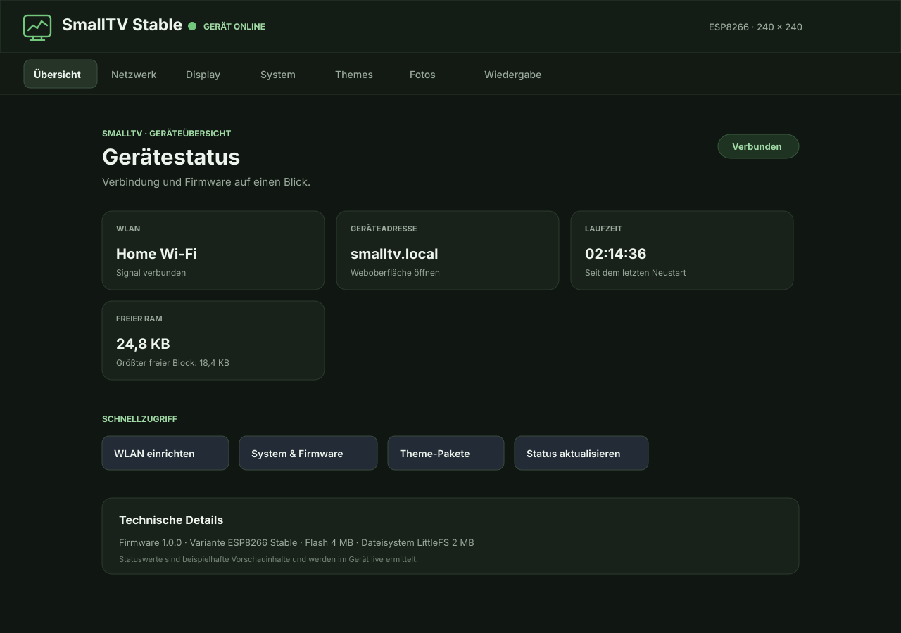
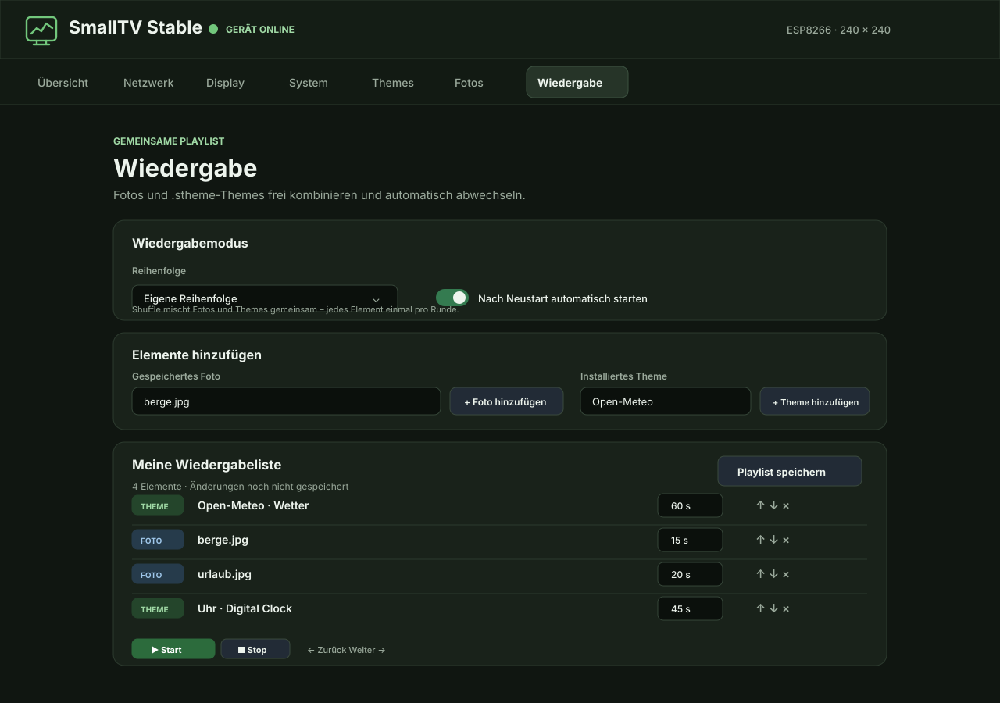

# SmallTV Stable

[](https://github.com/jamedegnato-kostal/smalltv-ultra-mod/actions/workflows/build.yml)
[](https://www.espressif.com/en/products/socs/esp8266)
[](#hardware-and-flash-layout)
[](LICENSE)

A memory-conscious firmware for the **GeekMagic SmallTV Ultra**. It combines
ST7789 display output, a local browser-based control panel, installable
`.stheme` packages, a JPEG photo gallery and a configurable playlist that
mixes photos and themes.

The firmware targets the ESP8266 with 4 MB flash and a 240×240 ST7789 panel.
Themes render row by row and photos decode into small output blocks; the
application does not allocate a persistent full-screen framebuffer.

## At a glance

| | |
|---|---|
| **Board** | ESP8266 / ESP-12E-compatible SmallTV Ultra |
| **Display** | 240×240 ST7789 |
| **Flash layout** | 4 MB flash · 2 MB LittleFS · OTA-capable firmware slot |
| **Photos** | Up to 16 JPEGs, 240×240, up to 256 KiB each |
| **Themes** | Up to 16 validated `.stheme` packages |
| **Mixed playlist** | Up to 32 entries, photos and themes together |
| **Control** | Local web interface, no cloud account required |
| **Build** | PlatformIO · `smalltv_stable` |

## Web interface preview

The following previews illustrate the embedded browser interface. Labels and
status values shown in the images are sample content; the device displays live
network, memory and playlist state.

| Device overview | Mixed photo/theme playback |
|---|---|
|  |  |

The actual web interface is served locally by the firmware and is embedded in
[`src/webui_stable.h`](src/webui_stable.h).

## Features

### Display and device

- ST7789 panel support, SPI mode 3, rotation and RGB/BGR selection.
- Persistent brightness, inversion and per-channel colour adjustment.
- Timezone-aware night mode (disabled by default; 22:00–07:00 and 5% brightness defaults).
- NTP-backed clock tokens and time bindings for themes.
- German and English localized theme text.

### Themes and data

- Install, validate, activate and remove `.stheme` packages.
- Row-based rendering for text, image, font, animation and scrolling layers.
- Generic JSON HTTP data sources with bounded streaming, selected-field caching
  and retry backoff.
- Included Open-Meteo demo package in `examples/open-meteo/`.

### Photos and mixed playback

- Browser-side conversion to 240×240 JPEG before upload.
- Up to 16 photos in LittleFS; maximum converted file size 256 KiB.
- Standalone photo slideshow with 5–3,600 second interval.
- Shared playlist containing any combination of photos and themes.
- Manual ordering with drag-and-drop or arrow controls.
- Shuffle without immediate repetition between rounds.
- Per-item duration from 5 to 3,600 seconds.
- Previous/next, start/stop and optional automatic start after reboot.

### Device management

- Wi-Fi client, setup access point, captive-portal redirect and mDNS.
- Local status and memory information.
- Configuration export/import, restart and full LittleFS factory reset.
- Manual firmware upload using a locally downloaded BIN file. There is no online updater; download the firmware BIN separately and install it in System.

## Getting started

1. Install the firmware on the SmallTV Ultra ESP8266.
2. If the stock updater rejects the full image, use the separate first-install
   loader described below.
3. If no saved Wi-Fi network is available, connect to the open
   `SmallTV-Setup` access point.
4. Open `http://192.168.4.1`, enter the 2.4 GHz Wi-Fi credentials and save.
5. Reopen the control panel at the device IP address or its mDNS hostname.
6. Open **Themes** to install a `.stheme`, **Fotos** to upload pictures, or
   **Wiedergabe** to create a mixed playlist.

### First installation with the loader

The loader is only needed on units whose stock updater cannot accept the full
firmware image. Flash `smalltv-stable-loader.bin`, connect to the
`SmallTV-Loader` access point, open `http://192.168.4.1/update` and upload
`smalltv-stable-firmware.bin`. The loader is a temporary installation helper,
not a normal firmware update. Subsequent updates are installed manually by uploading the matching firmware BIN in the device web UI.

## Mixed playlist

The **Wiedergabe** tab stores one ordered list of photo and theme items in
LittleFS. For example:

```text
Open-Meteo → Photo 01 → Photo 02 → Clock Theme → Photo 03
```

Choose fixed order or shuffle. Shuffle processes every configured item once
per round and avoids placing the previous round's final item first in the next
round. Each item has its own display duration. The playlist is restored after
reboot; auto-start is optional.

The playlist controller reuses the existing theme and JPEG renderers. Its RAM
state is limited to 32 descriptors and a 32-byte ordering array; it does not
store decoded images or theme assets. Stop playback before changing the gallery
or installed theme collection.

See [the architecture notes](docs/ARCHITECTURE.md) for the display ownership,
LittleFS layout and memory strategy.

## Hardware and flash layout

The standard PlatformIO target is configured for an ESP8266 module with **4 MB
flash** and the `eagle.flash.4m2m.ld` linker layout. It reserves approximately
2 MB for LittleFS while retaining an OTA-capable firmware area of approximately
1 MB. Filesystem metadata means the full nominal partition is not available for
user files.

**Do not use this firmware layout on modules with less than 4 MB flash.**

The previous `4m1m` partition boundary is different. Files in the old
filesystem are not migrated automatically. Before changing layouts, export
settings and keep separate copies of installed `.stheme` packages and photos.
If LittleFS is unavailable after the transition, the factory-reset operation
initializes the new partition but erases its contents; then restore the settings
backup and upload the themes/photos again.

## Factory reset

The confirmed **Factory Reset** action reformats the complete LittleFS data
partition, not just `config.json`. It removes settings and Wi-Fi credentials,
installed themes, gallery photos, the playlist and temporary/index files. The
firmware image itself remains installed. After reboot, Wi-Fi must be configured
again.

## Security and operational notes

- The setup access point and local web interface are open and have no password.
  Use the device only on a trusted network; do not expose it directly to the
  public internet.
- Configuration exports contain Wi-Fi credentials and must be treated as
  secrets.
- HTTPS data sources require the explicit `insecureTls: true` opt-in because
  certificate validation is not configured in the current ESP8266 firmware.
  This is not equivalent to certificate verification; use trusted endpoints.
- The device requires network access for Wi-Fi connection, NTP and remote theme
  data sources. The local web UI itself is served by the device.

## Build and test

Install Python 3, a C++ compiler and PlatformIO Core:

```sh
python -m pip install platformio
pio run -e smalltv_stable
```

Additional build targets:

```sh
pio run -e smalltv_display_check
pio run -e smalltv_loader
```

Host-side regression checks:

```sh
g++ -std=c++11 -Wall -Wextra -Werror tests/playback/test_playback_order.cpp -o /tmp/playback-order-tests
/tmp/playback-order-tests

g++ -std=c++11 -Wall -Wextra -Werror -Isrc tests/night_schedule/test_night_schedule.cpp -o /tmp/night-schedule-tests
/tmp/night-schedule-tests

python tests/factory_reset/check_factory_reset.py
python tools/pack_stheme.py examples/open-meteo/theme.json --check examples/open-meteo/open-meteo.stheme
```

GitHub Actions runs the regression checks and builds the firmware, display
check and loader on pushes to `main` and `stable-image`. Version tags named
`v*` publish exactly two binary assets: the main firmware and the first-install loader. The Open-Meteo `.stheme` remains a source example in `examples/` and is not attached to releases.

## Project notes

- [Firmware architecture](docs/ARCHITECTURE.md)
- [Web UI previews](docs/previews/README.md)
- [Theme data-source format and limits](src/theme/DATA_SOURCES.md)
- [Display implementation](src/display/README.md)
- [Theme parser provenance](src/theme/UPSTREAM.md)
- [Contributing](CONTRIBUTING.md)
- [Third-party notices](NOTICE.md)
- [License](LICENSE)

## Current limitations

- No physical-button control.
- No web login or access-password system.
- No ESP32-C2, classic ESP32 or SmallTV Pro target.
- No automatic language/locale-based scheduling.
