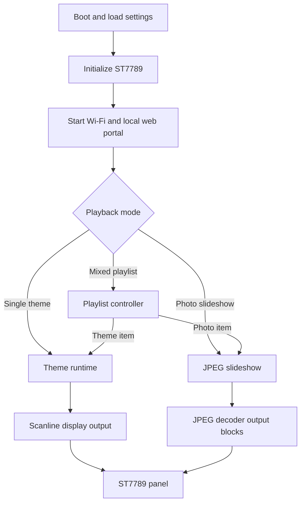

# Firmware architecture

SmallTV Stable is an ESP8266 application with one ST7789 display, a local
web portal and a LittleFS data partition. The display runtime is deliberately
single-owner: a selected theme, the photo slideshow or the mixed playlist
controls the display at a given time.

## Runtime flow

## LittleFS data

| Path | Purpose |
|---|---|
| `/config.json` | Wi-Fi and device configuration |
| `/themes/` | Installed `.stheme` packages and package index |
| `/photos/` | Converted JPEG gallery images |
| `/playlist.txt` | Mixed photo/theme playlist |
| `/playlist.tmp` | Staged playlist update before publication |

The confirmed factory-reset action formats LittleFS, removing all of the above.

## Memory strategy

- Theme packages are read through bounded sources; selected assets are streamed.
- Theme rendering writes dirty rows to the ST7789 instead of retaining a
  240×240 framebuffer.
- JPEG photos decode from LittleFS into the decoder's small output blocks.
- The mixed playlist stores at most 32 item descriptors and a 32-byte order
  array. It does not cache image pixels or theme assets.
- JSON data-source responses and selected fields use explicit size budgets.

## Important boundaries

- Only one display renderer is active at a time.
- Stop mixed playback before adding or deleting items, changing an individual
  theme selection, or starting the standalone slideshow.
- The 4 MB flash target uses `eagle.flash.4m2m.ld`: approximately 2 MB for
  LittleFS and an OTA-capable firmware slot. Do not flash this layout to modules
  with less than 4 MB flash.
- The first-install loader uses a separate temporary layout and is not a normal
  OTA update.
